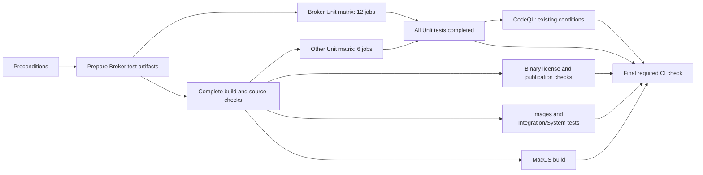

<!--

    Licensed to the Apache Software Foundation (ASF) under one
    or more contributor license agreements.  See the NOTICE file
    distributed with this work for additional information
    regarding copyright ownership.  The ASF licenses this file
    to you under the Apache License, Version 2.0 (the
    "License"); you may not use this file except in compliance
    with the License.  You may obtain a copy of the License at

      http://www.apache.org/licenses/LICENSE-2.0

    Unless required by applicable law or agreed to in writing,
    software distributed under the License is distributed on an
    "AS IS" BASIS, WITHOUT WARRANTIES OR CONDITIONS OF ANY
    KIND, either express or implied.  See the License for the
    specific language governing permissions and limitations
    under the License.

-->

## GitHub Workflows

This directory contains all Pulsar CI checks.

### Required Workflows

When adding new CI workflows, please update the [.asf.yaml](../../.asf.yaml) if the workflow is required to pass before
a PR can be merged. Instructions on how to update the file are below.

This project uses the [.asf.yaml](../../.asf.yaml) to configure which workflows are required to pass before a PR can
be merged. In the `.asf.yaml`, the required contexts are defined in the `github.protected_branches.*.required_status_checks.contexts.[]`
where * is any key in the `protected_branches` map.

You can view the currently required status checks by running the following command:

```shell
curl -s -H 'Accept: application/vnd.github.v3+json' https://api.github.com/repos/apache/pulsar/branches/master | \
jq .protection
```

These contexts get their names in one of two ways depending on how the workflow file is written in this directory. The
following command will print out the names of each file and the associated with the check. If the `name` field is `null`,
the context will be named by the `id`.

```shell
for f in .github/workflows/*.yaml; \
do FILE=$f yq eval -o j '.jobs | to_entries | {"file": env(FILE),"id":.[].key, "name":.[].value.name}' $f; \
done
```

Duplicate names are allowed, and all checks with the same name will be treated the same (required or not required).

### CI build and test dependencies

`pulsar-ci.yaml` prepares Broker test dependencies before building the complete distribution. Broker Unit jobs
consume `broker-test-build-outputs`; the remaining Unit jobs, image builds and publication checks consume the
complete build outputs or wait for the complete build. This lets Broker tests start while distribution assembly
continues. Binary license and publication validation remain required through the final CI check.



Five Broker groups use two class shards each. `-PtestClassShard=1/2` and `2/2` assign top-level class names by
CRC32, keeping nested classes together and leaving the runtime classpath intact. TestNG group filters, inherited
methods, factories and data providers still apply. The original unsharded dispatcher names remain available for
local reproduction. Isolated tests are invoked once outside the shard filter. Run
`python3 pulsar-build/verify_ci_broker_shards.py` and `python3 pulsar-build/verify_ci_test_partitions.py` to check the
dispatcher and suite partitions without Docker. The Gradle/TestNG fixture can also be run with
`python3 pulsar-build/tests/test_ci_test_class_shards.py`.

The build output archives exclude `.gradle` directories. Gradle caches are managed separately by `setup-gradle`;
a cold or incompatible cache can still cause compilation after an archive is restored. Compare actual compilation
steps, artifact transfer time, queue time and accumulated runner minutes when assessing the benefit. CRC32 gives
a stable initial assignment, but class counts do not guarantee equal test duration. Use successful test XML reports
retained in personal CI to measure the next balancing change against the same-revision baseline. Overall CI time
is measured through the final required check, including CodeQL and publication validation.

When working on workflow changes, one way to find out the names of the status checks is to retrieve the names
from the PR build run. The "check-runs" can be found by commit id. Here's an example:

```shell
curl -s "https://api.github.com/repos/apache/pulsar/commits/$(git rev-parse HEAD)/check-runs" | \
  jq -r '.check_runs | .[] | .name' |sort
```
